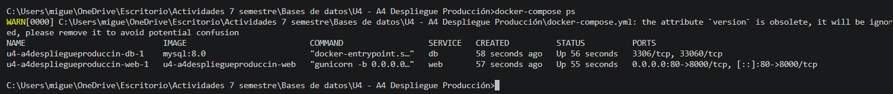
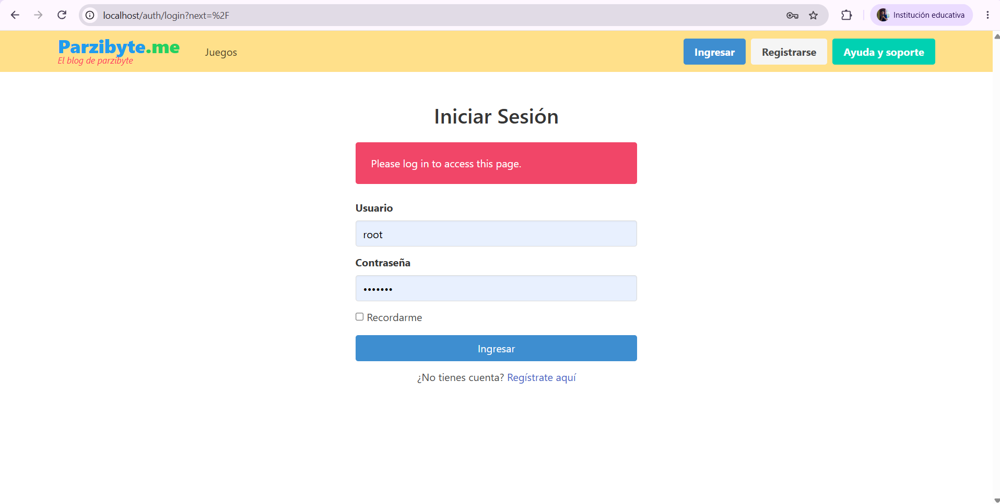
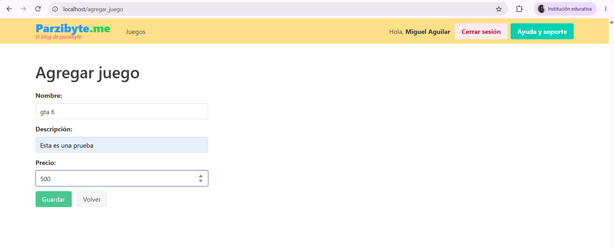
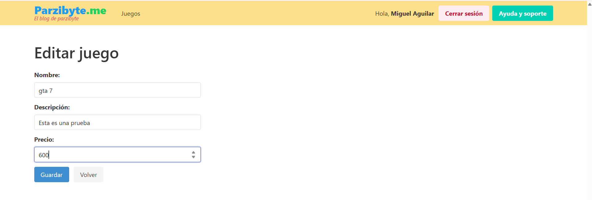
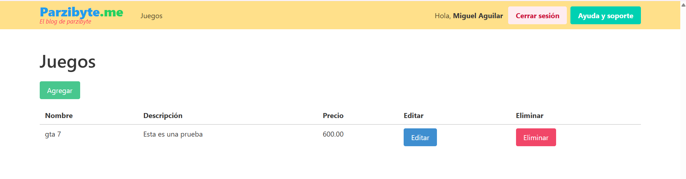

# U4 - A4: Despliegue de Producción del Mini-Sistema de Videojuegos

En esta actividad realicé el despliegue en producción de mi aplicación web de videojuegos desarrollada con Flask, utilizando Docker, Docker Compose, Gunicorn y MySQL. El sistema conserva las funcionalidades de registro de usuarios, inicio de sesión, manejo de sesiones protegidas y administración (listado, registro y edición) de videojuegos.

## A. Pasos para levantar la aplicación

1. Clonar el repositorio y entrar a la carpeta del proyecto:
   ```bash
   git clone [https://github.com/miguelberumen/videojuegos-prod.git](https://github.com/miguelberumen/videojuegos-prod.git)
   cd videojuegos-prod
   ```

2. Crear un archivo `.env` en la raíz del proyecto con las variables de entorno necesarias para la base de datos y la aplicación.

3. Construir la imagen y levantar los contenedores en segundo plano:
   ```bash
   docker-compose up --build -d
   ```

4. Esperar unos segundos a que MySQL termine de inicializarse y abrir la aplicación en el navegador en:
   `http://localhost`

## B. Variables de entorno

Para evitar colocar contraseñas o claves directamente en el código fuente, la aplicación lee su configuración desde variables de entorno mediante `os.environ` y un archivo local `.env` (ignorado en Git):

- **`DATABASE_URL`**: Define la cadena de conexión entre Flask y el contenedor de MySQL usando PyMySQL (por ejemplo: `mysql+pymysql://usuario:contraseña@db/videojuegos`).
- **`SECRET_KEY`**: Clave secreta que utiliza Flask para firmar las sesiones de usuario y proteger los formularios con Flask-Login y Flask-WTF.
- **`MYSQL_ROOT_PASSWORD`**, **`MYSQL_DATABASE`**, **`MYSQL_USER`** y **`MYSQL_PASSWORD`**: Variables empleadas por el servicio `db` de Docker Compose para crear automáticamente la base de datos y el usuario de MySQL al iniciar el contenedor.

## C. Comandos Docker y Docker Compose utilizados

- **Construir la imagen y levantar los servicios en segundo plano:**
  ```bash
  docker-compose up --build -d
  ```

- **Verificar que los contenedores (`web` y `db`) estén activos y en ejecución:**
  ```bash
  docker-compose ps
  ```

## D. Capturas de pantalla

### 1. Contenedores activos en Docker Compose


### 2. Inicio de sesión y registro de usuarios en http://localhost


### 3. Registro de un nuevo videojuego


### 4. Edición de un videojuego existente


### 5. Listado de videojuegos con sesión activa
